# 🎬 High-Precision Multi-Entity Search Engine & Ingestion Pipeline

An enterprise-grade, low-latency search engine built on **Elasticsearch 8/9**, **NestJS**, and **Angular 17+ (Signals)**. Designed to solve real-world information retrieval challenges: Lucene score pollution, cross-field highlighter desynchronization, zero-downtime index migrations, and resilient streaming ingestion across 46,000+ catalog entities.

---

## 🏗️ Architecture Overview

```mermaid
flowchart TD
    subgraph Ingestion ["Data Ingestion & Zero-Downtime Migration"]
        NDJSON["movies_bulk-2.ndjson\n(46,629 Docs)"] --> Stream["Stream Generator\n(Chunked Backpressure)"]
        Stream --> Sanitize["Unicode Sanitizer\n(U+2028 / U+2029)"]
        Sanitize --> PhysicalIndex["Physical Index:\nimdbmovies_<timestamp>"]
        PhysicalIndex --> Refresh["POST /_refresh"]
        Refresh --> AtomicAlias["POST /_aliases\n(Atomic Pointer Swap)"]
        AtomicAlias --> AliasPointer["Alias: imdbmovies_alias"]
    end

    subgraph RuntimeEngine ["Runtime Search Engine"]
        Client["Angular 17 (Signals + RxJS)"] -->|"GET /search?query=&type=&page=&genre="| Controller["NestJS SearchController"]
        Controller --> Service["SearchService"]
        Service --> QueryRouter{"Query Partition"}
        QueryRouter -->|Length <= 2| TitlePrefix["Title-Only Filter\n(Prevents Cast Pollution)"]
        QueryRouter -->|Length >= 3| MultiEntity["Multi-Entity Dis_Max\n(Titles, Cast, Directors, Genres)"]
        MultiEntity --> Lucene["Lucene Inverted Index\n(Stemmer + Synonyms + Shingles)"]
        Lucene --> HighlightSync["Scoped highlight_query\n(Synchronized Highlighting)"]
        HighlightSync --> Aggs["Terms & Range Faceting\n(Genre Counts & Rating Buckets)"]
        Aggs --> Response["{ result, pagination, facets }"]
    end
```



---

## 🚀 Key Engineering Innovations & Problems Solved

### 1. Eliminating Multi-Field Score Pollution (`dis_max` vs `bool.should`)
* **Problem:** In multi-field search (e.g. searching across `movie_title`, `cast`, `director`, and `overview`), standard `bool.should` sums BM25 scores additively. A movie with 4 weak peripheral matches in plot overview would outrank a film with an exact title match.
* **Solution:** Replaced additive scoring with `dis_max` (`tie_breaker: 0.2`). The document’s score is dictated by the single highest-scoring field, while secondary matching fields contribute only a small fraction ($20\%$). Exact and phrase matches (`match_phrase` with `slop: 1`) receive heavily boosted priority.

### 2. Resolving Lucene Highlighter Desynchronization
* **Problem:** When querying across multiple fields with edge n-grams or compound normalizers, standard highlighters with `require_field_match: false` highlight matching character sequences in the wrong field (e.g. typing `"spid"` returned *Spider-Man* but highlighted actor `"Sid"` in the cast list while leaving the title unhighlighted).
* **Solution:** Decoupled candidate retrieval from highlighter offset marking using explicit, scoped `highlight_query` payloads on individual fields (`movie_title`, `director`, `cast`).

### 3. Entity Disambiguation for Short Prefix Queries
* **Problem:** Single-letter or two-letter queries (e.g., typing `"H"`) flooded search results with movies featuring actors starting with H (e.g., Heath Ledger in *The Dark Knight*), completely drowning out movies titled *Harry Potter* or *Her*.
* **Solution:** Implemented query length partitioning: queries with $\le 2$ characters search strictly against movie title keyword and prefix normalizers, expanding to cast, directors, and taxonomy entities only once query intent exceeds 2 characters.

### 4. Zero-Downtime Blue/Green Re-Indexing (`_aliases`)
* **Problem:** Lucene segments on disk are immutable; altering tokenizers, stemmers, or mappings requires re-indexing. In-place re-indexing causes query 404s and partial read results.
* **Solution:** Ingestion targets timestamped physical indices (`imdbmovies_<timestamp>`). Once bulk loading completes and segments are flushed with `_refresh`, the script executes an atomic alias swap (`POST /_aliases`) with zero downtime ($<10\text{ms}$) and instant rollback capability.

### 5. Resilient Streaming NDJSON Ingestion
* **Problem:** Standard Node.js `readline` interfaces treat ECMAScript Unicode line separators (`U+2028` and `U+2029`) as line breaks. In movie overviews, this split single JSON objects across multiple lines, causing unrecoverable HTTP 400 JSON parse errors.
* **Solution:** Built a custom byte-level buffer stream generator that splits strictly on `\n` (`0x0A`), sanitizes Unicode terminators in flight, and streams records in chunks of 1,000 documents with backpressure management.

### 6. Linguistic Analysis Pipeline
* **Search-Time `synonym_graph`:** Handles multi-word film aliases (e.g., `"sci-fi"` ➔ `"science fiction"`, `"romcom"` ➔ `"romantic comedy"`) dynamically at query time without index bloat or phrase offset degradation.
* **Morphological Stemming:** English Porter stemmer (`english_stemmer`) and stopword filter allow variations like `"alien"` and `"aliens"`, or `"running"` and `"run"`, to match intuitively.

---

## 🛠️ Tech Stack

| Layer | Technologies |
| :--- | :--- |
| **Search Engine** | Elasticsearch 8/9, Lucene Inverted Index, BM25, Custom Analyzers |
| **Backend API** | NestJS 11, TypeScript, `@nestjs/elasticsearch`, Zod Validation |
| **Frontend Client** | Angular 17+, Standalone Components, Signals, RxJS Reactive Streams |
| **Data & Infra** | NDJSON Ingestion Stream, Docker Compose, Multi-stage Dockerfiles |

---

## ⚡ Quickstart

### Option 1: One-Command Docker Setup
Ensure Docker Desktop is running, then run:

```bash
docker compose up --build
```
- **Frontend:** [http://localhost:4200](http://localhost:4200)
- **Backend API:** [http://localhost:3000](http://localhost:3000)
- **Elasticsearch:** [http://localhost:9200](http://localhost:9200)

### Option 2: Local Development Setup

#### 1. Start Elasticsearch
```bash
docker run -d -p 9200:9200 -e "discovery.type=single-node" -e "xpack.security.enabled=false" docker.elastic.co/elasticsearch/elasticsearch:8.17.0
```

#### 2. Ingest Dataset
```bash
cd data
node ingestion.js
```

#### 3. Start Backend
```bash
cd backend
cp .env.example .env
npm install
npm run start:dev
```

#### 4. Start Frontend
```bash
cd frontend
npm install
npm start
```

---

## 📡 API Specification

### Search Endpoint: `GET /search`

**Query Parameters:**
| Parameter | Type | Default | Description |
| :--- | :--- | :--- | :--- |
| `query` | `string` | *(Required)* | Search query string |
| `type` | `string` | `'all'` | Entity filter: `'all'`, `'movie'`, `'director'`, `'actor'`, `'keyword'` |
| `page` | `number` | `1` | Pagination page number |
| `limit` | `number` | `30` | Number of results per page |
| `genre` | `string` | *(Optional)* | Strict genre term filter |

**Sample Response:**
```json
{
  "result": [
    {
      "id": "155",
      "movie_title": "The Dark Knight",
      "director": "Christopher Nolan",
      "cast": "Christian Bale, Heath Ledger, Aaron Eckhart",
      "genres": ["Action", "Crime", "Drama"],
      "imdb_rating": 9.0,
      "highlight": "<mark>The Dark Knight</mark>"
    }
  ],
  "pagination": {
    "total": 1,
    "page": 1,
    "limit": 30,
    "totalPages": 1
  },
  "facets": {
    "genres": [
      { "key": "Drama", "doc_count": 1 },
      { "key": "Action", "doc_count": 1 }
    ],
    "ratings": [
      { "key": "9.0 - 10.0", "doc_count": 1 }
    ]
  }
}
```
